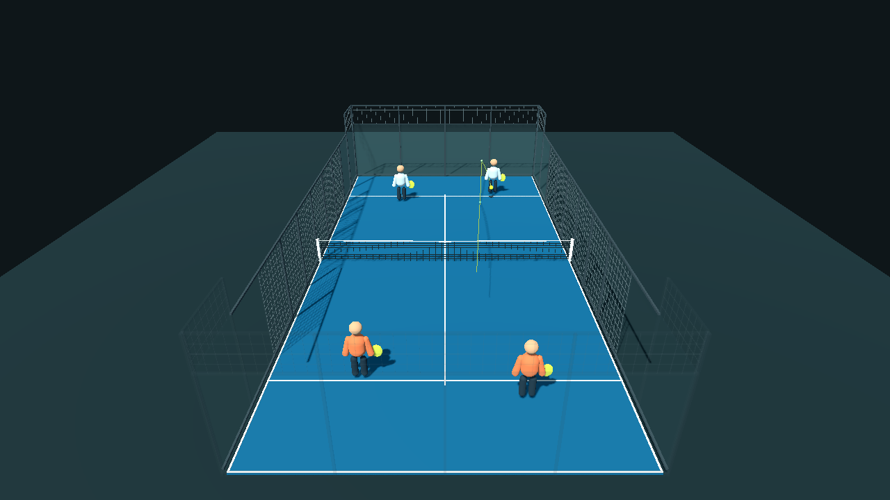

# Pádel Arcade — nombre provisional

Juego de pádel 3D para PC, con jugabilidad arcade inspirada en Virtua Tennis y adaptación posterior a celular. Desarrollo individual asistido por Codex. Documentación en español.

**Estado al 27/10/2026, sesión 005:** laboratorio de pelota con gravedad, colisiones y siete lanzamientos repetibles. Cámara aprobada y rejas corregidas. Vidrio amortiguado y reja con dispersión reproducible. Todavía sin giro, jugador controlable, golpes ni partido.

En Linux: `./tools/run-godot.sh`. **F1–F7:** lanzamientos; **Espacio:** pausa; **R:** repetir; **N:** variar reja; **L:** repetición automática; **1/2/3:** cámaras; **G:** atenuar vidrio.

[Guía y video del laboratorio](docs/LABORATORIO_PELOTA.md). [Vistas de cámara de E1](docs/CAMARA.md).

## Por dónde seguir

1. Leer [Estado y siguiente sesión](docs/ESTADO.md).
2. Consultar el [Plan por etapas](docs/PLAN.md) y la [visión del juego](docs/JUEGO.md).
3. Seguir la [preparación del entorno](docs/ENTORNO.md) para abrir `game/project.godot`.
4. Revisar los rebotes del laboratorio y continuar con movimiento y primer golpe (E3).

## Mapa del proyecto

| Ruta | Contenido |
| --- | --- |
| `game/` | Proyecto importable en Godot |
| `docs/JUEGO.md` | Experiencia, controles propuestos y alcance |
| `docs/LABORATORIO_PELOTA.md` | Controles, parámetros y evidencia de rebotes |
| `docs/PLAN.md` | Etapas, tareas y condiciones para avanzar |
| `docs/DECISIONES.md` | Acuerdos, propuestas y decisiones pendientes |
| `docs/ESTADO.md` | Punto exacto de continuidad y próxima tarea |
| `docs/BITACORA.md` | Cambios y comprobaciones por sesión |
| `docs/ARQUITECTURA.md` | División técnica prevista |
| `docs/PRUEBAS.md` | Escenarios y resultados |
| `docs/ENTORNO.md` | Herramientas, apertura y control de versiones |
| `docs/SKILLS.md` | Skills e instalación |
| `docs/FUENTES.md` | Fuentes y procedencia de assets |
| `docs/references/` | Imagen de referencia aportada |
| `skills/` | Copias versionadas de las skills propias |

## Forma de trabajo

Una tarea pequeña a la vez: implementar, probar, revisar juntos y documentar. Estimaremos fechas después de completar un ciclo real. Una etapa se termina por su evidencia, no por haber creado archivos.

Virtua Tennis es una referencia de experiencia. La fotografía es una referencia de cámara, no un asset para publicar dentro del juego. Personajes, audio y assets definitivos serán propios o tendrán permisos registrados.
