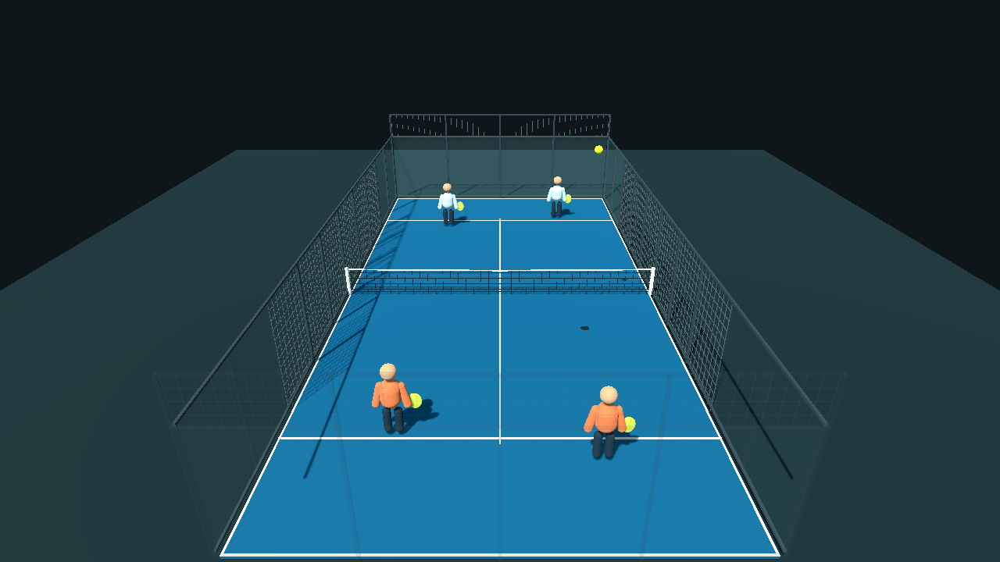

# Referencia de cámara — E1, sesiones 002/003

Estas capturas corresponden al laboratorio visual E1. Desde sesión 004 la escena normal usa física; ver LABORATORIO_PELOTA.md. El modo de trayectoria programada se conserva para comprobar encuadre.

## Vista 1 — referencia inicial

Posición (0,10,18), objetivo (0,0.5,0), FOV vertical 52°. La pared cercana está atenuada para ver la acción. Encuadre aprobado por el usuario en sesión 003.

## Vista 2 — más atrás

Posición (0,12,21), mismo objetivo y FOV. Muestra más entorno a cambio de reducir el tamaño de jugadores y pelota.

## Vista 3 — más cerca

Posición (0,9,17), mismo objetivo y FOV.

## Probar

Para reproducir el modo visual E1 en Linux: `./tools/run-godot.sh -- --camera-preview`. La ejecución normal abre el laboratorio físico E2.

- **1/2/3:** cambiar cámara.
- **G:** alternar atenuación del cerramiento cercano.
- **Espacio:** pausar/reanudar trayectoria visual.
- **R:** volver al comienzo de la trayectoria.

La ventana indica estos controles en su título. No hay controles de jugador todavía.

## Evidencia y límites

Se comprobó el encuadre en 1280×720 y 640×360 para las tres vistas, con extremos del cerramiento y 101 muestras de trayectoria. Es una comprobación geométrica, no una garantía de legibilidad ni de ausencia de toda oclusión. La pelota tiene un radio visual ampliado de 0.105 m para esta prueba. En 360p su diámetro llega a unos 2.4–2.9 píxeles: la adaptación móvil necesita trabajo específico.

El arte, las figuras y los cerramientos son provisionales. Las rejas laterales se corrigieron en sesión 003: extremos de 4 m y tramo central de 3 m, siguiendo la variante de cristal FIP. Los accesos laterales siguen pendientes. Las colisiones físicas se incorporaron en E2 y no están representadas por estas capturas históricas.
