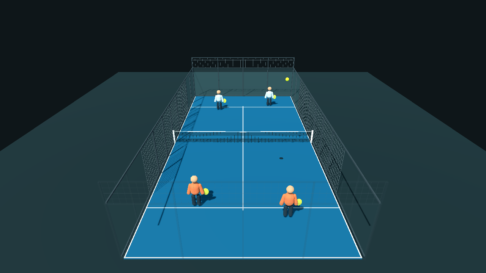
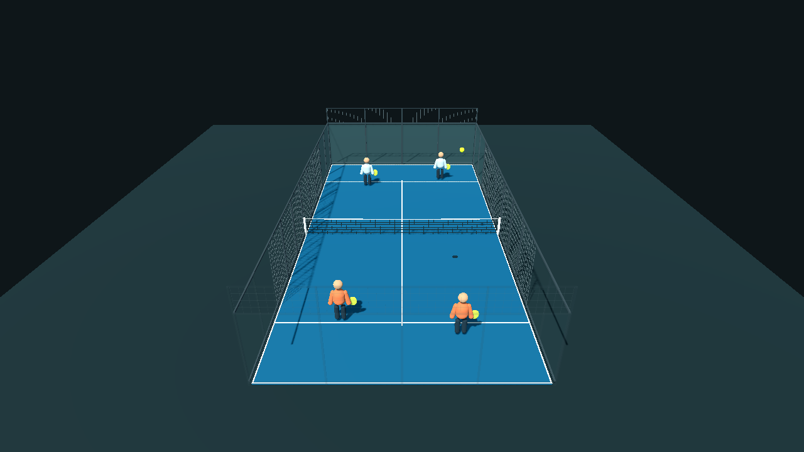

# Laboratorio de cámara — sesión 002

Prototipo visual para elegir encuadre. No es todavía un juego: los jugadores no se mueven y la pelota sigue una trayectoria programada, sin rebotes físicos.

## Vista 1 — referencia inicial

Posición (0,10,18), objetivo (0,0.5,0), FOV vertical 52°. La pared cercana está atenuada para ver la acción. Es la propuesta inicial, todavía por revisar con el usuario.

## Vista 2 — más atrás

Posición (0,12,21), mismo objetivo y FOV. Muestra más entorno a cambio de reducir el tamaño de jugadores y pelota.

## Vista 3 — más cerca

Posición (0,9,17), mismo objetivo y FOV.

## Probar

Desde la raíz del proyecto en Linux: `./tools/run-godot.sh`.

- **1/2/3:** cambiar cámara.
- **G:** alternar atenuación del cerramiento cercano.
- **Espacio:** pausar/reanudar trayectoria visual.
- **R:** volver al comienzo de la trayectoria.

La ventana indica estos controles en su título. No hay controles de jugador todavía.

## Evidencia y límites

Se comprobó el encuadre en 1280×720 y 640×360 para las tres vistas, con extremos del cerramiento y 101 muestras de trayectoria. Es una comprobación geométrica, no una garantía de legibilidad ni de ausencia de toda oclusión. La pelota tiene un radio visual ampliado de 0.105 m para esta prueba. En 360p su diámetro llega a unos 2.4–2.9 píxeles: la adaptación móvil necesita trabajo específico.

El arte, las figuras y los cerramientos son provisionales. El lateral no tiene accesos y no existen colisiones. El siguiente paso tras revisar el encuadre es desarrollar el laboratorio de rebotes.
