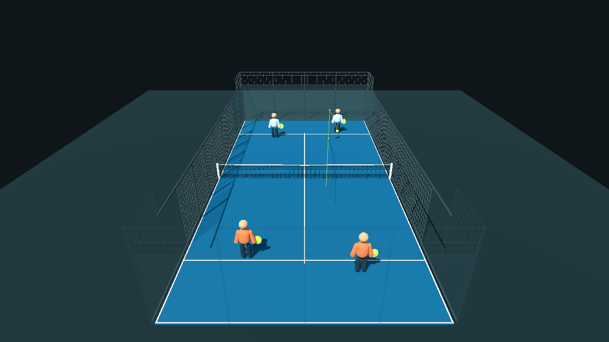

# Laboratorio de pelota — sesión 004

La escena principal ahora usa gravedad y colisiones. La cámara y la geometría lateral aprobadas se conservan. Los jugadores todavía son figuras sin control ni colisión.

## Abrir y probar

Desde la raíz del proyecto en Linux:

```bash
./tools/run-godot.sh
```

| Tecla | Acción |
| --- | --- |
| F1 | Caída vertical |
| F2 | Tiro que pica y llega al vidrio de fondo; lanzamiento inicial |
| F3 | Reja lateral |
| F4 | Tiro bajo contra la red |
| F5 | Esquina de vidrio |
| F6 | Tiro rápido de 60 m/s |
| F7 | Globo |
| Espacio | Pausar/reanudar la física |
| R | Repetir el lanzamiento seleccionado desde su estado inicial |
| L | Activar/desactivar repetición automática cada seis segundos; también relanza si cae fuera |
| 1/2/3 | Cambiar cámara |
| G | Atenuar el cerramiento cercano; la colisión no cambia |

El título de la ventana muestra escenario y último contacto. La estela dibuja posiciones recientes; las marcas indican contacto con piso (celeste), vidrio (verde), reja (naranja) o red (rojo). Se limpian al relanzar. No se añaden todavía reglas de punto.



[Video de cuatro segundos del lanzamiento F2](previews/ball-lab.mp4).

## Modelo elegido (P20)

Se compararon las responsabilidades de estas alternativas, sin construir dos motores completos:

| Alternativa | Ventaja | Costo para este proyecto |
| --- | --- | --- |
| RigidBody3D y materiales físicos | Integración y contactos administrados por el motor | Menor control directo del orden de rebotes y futura trayectoria de tiro; requeriría adaptar la captura de contactos |
| CharacterBody3D con integración y barrido de movimiento | Velocidad y respuesta controladas, contactos ordenados y relanzamientos explícitos | Hay que implementar gravedad, respuesta y reposo |
| Colisiones analíticas propias | Predicción controlada | Duplicaría detección de contactos, esquinas y geometría |

Se eligió **CharacterBody3D con move_and_collide**, integrado en pasos físicos de 1/120 s. Es física de prototipo con gravedad y rebotes, no una trayectoria animada. El barrido lo realiza Godot; después del impacto se resuelve el tiempo restante y puede haber más de un contacto en el mismo paso. Presupuesto máximo: ocho impactos; si se agota, se descarta el tiempo restante conservadoramente y se registra. No ocurrió en las pruebas.

No se implementa todavía efecto de giro, deformación de pelota, viento ni desviación aleatoria de la reja. La malla usa una superficie sólida equivalente para colisión, no colisiones con cada alambre. Las aberturas superiores permiten salir por encima del cerramiento.

## Parámetros iniciales (ajustables, no mediciones de material real)

| Parámetro | Valor |
| --- | --- |
| Gravedad | 9.81 m/s² |
| Radio físico y visual provisional | 0.105 m, ampliado para lectura; no reglamentario |
| Velocidad máxima de lanzamiento/simulación | 60 m/s |
| Restitución normal piso / vidrio / reja / red | 0.73 / 0.82 / 0.55 / 0.12 |
| Retención tangencial piso | 0.94 |
| Retención tangencial vidrio/reja | 0.98 |
| Retención tangencial red | 0.65 |
| Resistencia aérea | Amortiguación exponencial, coeficiente 0.04 s⁻¹ |
| Reposo | Se asienta al impactar piso por debajo de 0.8 m/s normal |

Los parámetros están expuestos en ball_simulation.gd. No se afirma fidelidad física reglamentaria ni ajuste final de diversión. Las condiciones iniciales de cada escenario están en launch_scenarios.gd, en metros y m/s.

## Registro de contactos

Cada contacto incluye secuencia, tiempo aproximado dentro del paso, superficie, collider, posición, normal, velocidades entrante/saliente, lado y último golpeador. Este último vale -1 porque aún no hay golpes de jugadores. No hay marcador ni ganador del punto. La gravedad se integra al comienzo del paso, por lo que el tiempo de impacto aproxima el movimiento dentro de esa discretización.

## Reproducir comprobaciones

```bash
./tools/run-godot.sh --headless --script res://tests/ball_checks.gd
./tools/run-godot.sh --headless --fixed-fps 30 --script res://tests/frame_rate_checks.gd -- --fps=30
./tools/run-godot.sh --headless --fixed-fps 60 --script res://tests/frame_rate_checks.gd -- --fps=60
./tools/run-godot.sh --headless --fixed-fps 120 --script res://tests/frame_rate_checks.gd -- --fps=120
python3 tools/compare-fps.py
./tools/run-godot.sh --headless --script res://tests/camera_checks.gd
```

Resultados: 13 escenarios físicos y controles de pausa/reanudación/reinicio/F4, cero fallos. El lanzamiento canónico de F2 a dos segundos coincide a 30/60/120 FPS de render programados, tolerancia 0.00001 m y 0.00001 m/s. Esto verifica independencia del ritmo de render en ese caso, no rendimiento de hardware ni determinismo entre plataformas.

Los JSON están en previews/ball-checks.json y previews/ball-fps-*.json. Ver PRUEBAS.md para alcance y evidencia.
