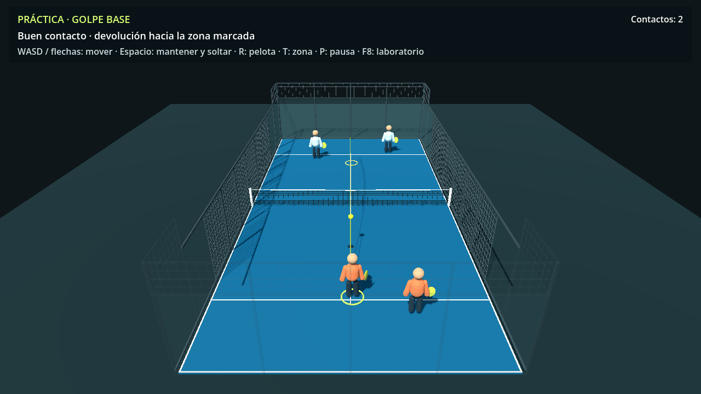

# Primera práctica jugable — sesión 007

Un jugador se mueve y devuelve pelotas de un lanzador. Se mantiene la cámara aprobada y la física calibrada de E2. Los otros tres personajes siguen estáticos; no hay rival, marcador ni partido.



[Demostración de seis segundos](previews/practice.mp4): entradas sintéticas de Godot realizan dos contactos. Es una prueba grabada, no un rival o asistente que juegue por el usuario.

## Empezar

Desde la raíz del proyecto en Linux:

```bash
./tools/run-godot.sh
```

1. El jugador naranja con aro es el que controlás. Al abrir, la pelota espera en el lanzador.
2. Pulsá **R**. La primera pelota llega por tu zona inicial, a la izquierda.
3. Movete con **WASD o flechas**. Llegá antes de preparar: durante preparación se reduce la velocidad.
4. Mantené **Espacio** para preparar y soltalo cuando la pelota esté cerca y a una altura alcanzable. No se golpea solo por mantenerlo.
5. **R** repite esa pelota. **T** cambia la zona de alimentación entre izquierda, centro y derecha y lanza.

Si aparece PAUSA al cambiar de ventana, pulsá **P** para continuar.

## Controles

| Acción | Teclado | Mando preparado en el mapa de acciones |
| --- | --- | --- |
| Moverse | WASD / flechas | Stick izquierdo |
| Preparar / solicitar golpe | Mantener / soltar Espacio | Mantener / soltar A |
| Recibir pelota | R | X |
| Cambiar zona y recibir | T | Y |
| Pausar / continuar | P o Escape | Start |
| Alternar laboratorio / práctica | F8 | Sin asignación todavía |
| Cámaras | 1/2/3 | Sin asignación todavía |
| Atenuar cerramiento cercano | G | Sin asignación todavía |

Los bindings de mando están configurados y se comprobaron con eventos sintéticos; falta probar un mando físico.

En ventana pequeña se muestran las instrucciones esenciales; las instrucciones completas están en esta guía. Los avisos informan preparación, contacto, pelota demasiado alta/baja o falta de alcance. El contador registra contactos de práctica, no puntos de un partido.

## Dirección y preparación

La dirección de movimiento al soltar el golpe también selecciona objetivo: izquierda/derecha desplazan el destino; hacia adelante busca más profundidad y hacia atrás un destino más corto. Sin dirección, apunta aproximadamente frente al jugador. El aro del campo rival representa el objetivo.

Preparación mínima: 0.10 s. La preparación completa se alcanza a 0.8 s; no sigue acumulando potencia después. Soltar abre una ventana de contacto de 0.20 s, seguida de recuperación de 0.35 s. El golpe intenta contactar una vez; si no llega la pelota a tiempo se informa el motivo. Un toque demasiado corto falla.

Son decisiones iniciales de diseño; todavía debe revisarlas el usuario con el juego abierto.

## Movimiento y contacto

- Velocidad máxima 5.2 m/s, aceleración 25 m/s²; preparando se usa el 60% de esa velocidad.
- Movimiento diagonal normalizado, con barridos de colisión y límites dentro de la mitad cercana. No hay salto ni cambio de lado.
- Alcance horizontal inicial 1.25 m; altura de contacto 0.22–2.1 m. Existe tolerancia limitada para una pelota que llega durante la ventana de golpe, no un golpe remoto.
- Pala con movimiento procedural provisional; no animación deportiva final ni esqueleto animado.
- Un solo contacto por intento y un solo golpe del jugador por pelota recibida. R/T vuelven a habilitar una nueva pelota.
- La bola conserva posición, reloj, historial de contactos y estado aleatorio al golpearla. El golpe cambia velocidad y último golpeador; no es un relanzamiento oculto.

El cuerpo del jugador colisiona con la cancha. La pelota no rebota contra los cuerpos de los personajes: esa interacción y su regla deportiva quedan pendientes.

## Ayuda de devolución inicial

El golpe base calcula una velocidad de salida para aterrizar cerca del aro rival usando el mismo paso de gravedad y resistencia de E2. Ajusta duración si hace falta para intentar pasar la red con margen (altura de centro de pelota al cruzar: al menos 1.3 m en la predicción). Esto es asistencia arcade explícita.

La pelota sigue recorriendo la trayectoria mediante física y colisiones. Si hay un impacto intermedio, ya no se garantiza el destino previsto. No se implementaron globo/remate del jugador ni giro de pelota. Los lanzamientos F1–F7 siguen siendo pruebas del laboratorio.

## Laboratorio anterior

F8 abre el laboratorio E2. También se puede iniciar con:

```bash
./tools/run-godot.sh -- --lab
./tools/run-godot.sh -- --scenario=7
```

F1–F7 desde práctica entran al laboratorio y seleccionan escenario. Allí Espacio pausa, R repite, N cambia semilla y L controla repetición. En práctica Espacio golpea y P pausa. F8 vuelve a práctica con el jugador en posición inicial y la pelota esperando R.

## Comprobaciones y límites

- `tests/player_checks.gd`: movimiento, límites, fallos de alcance/preparación/altura, un solo impacto, conservación de posición/reloj/RNG al golpear, pausa, foco y F8.
- 90 trayectorias con varias alturas, posiciones, potencias y direcciones: cruzan red y primer pique rival a menos de 0.4 m del objetivo.
- Práctica automática de 30 s: diez alimentaciones en tres zonas y diez contactos. Es integración técnica; **la comodidad y diversión siguen pendientes de prueba humana**.
- Grabación a 30 FPS programados mediante eventos de teclado/action: dos golpes reales en el motor.
- Interfaz comprobada en 1280×720 y 640×360. No equivale a adaptación móvil.

```bash
./tools/run-godot.sh --headless --script res://tests/player_checks.gd
```

Informe: `previews/player-checks.json`. Física y trayectoria anteriores conservadas; regresiones documentadas en PRUEBAS.md.
